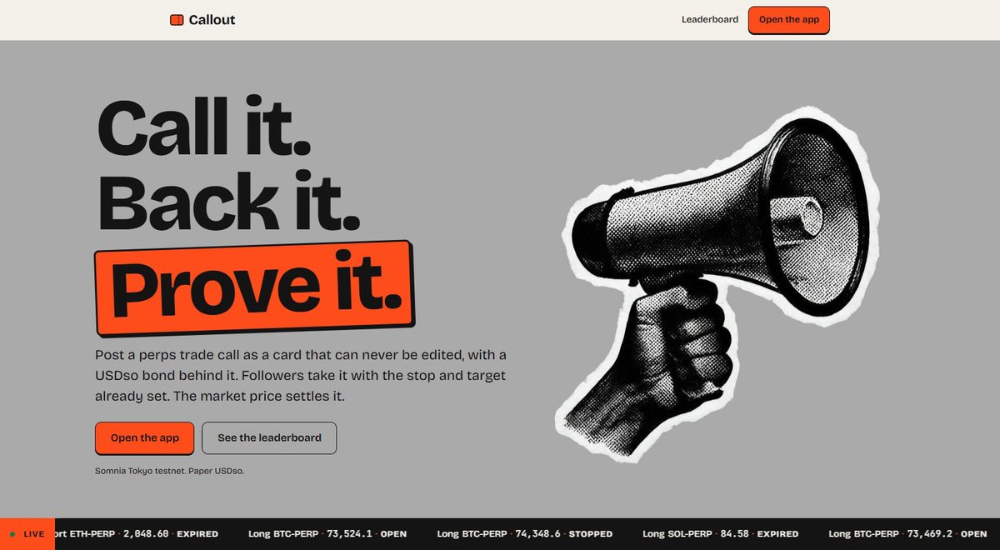
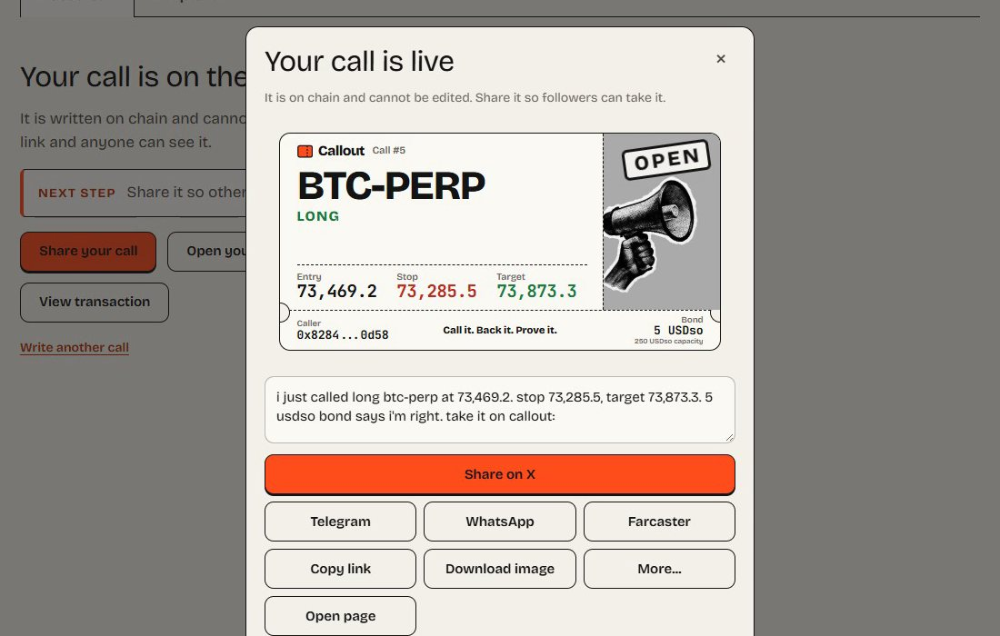
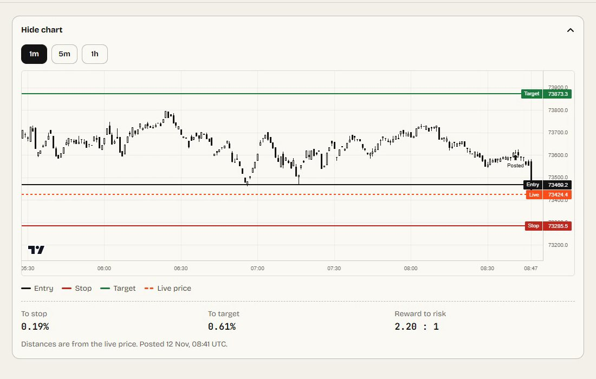
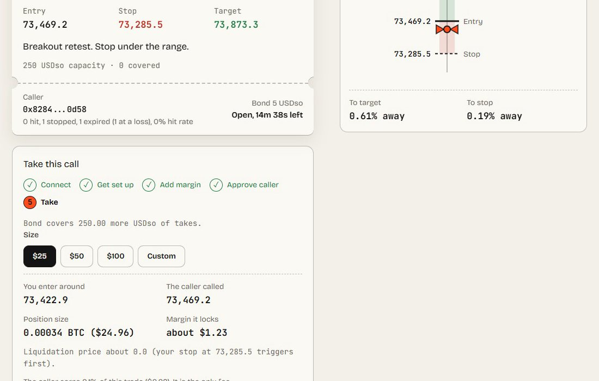
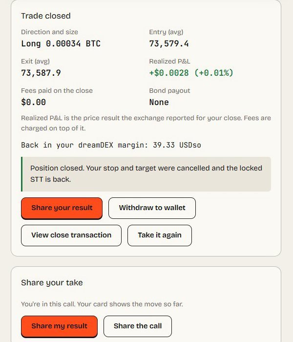
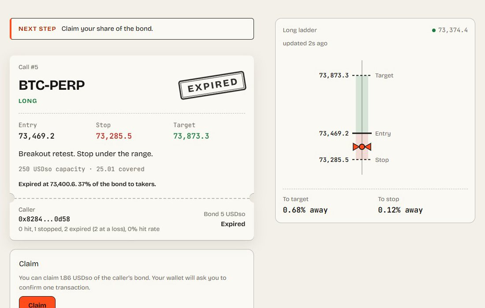
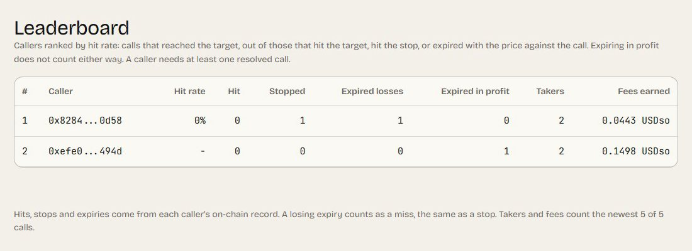

# Callout

**Post a perps call. Put a bond behind it. Get paid when people take it. Be wrong and your takers get paid.**

[](https://github.com/Techkeyy/callout/actions/workflows/ci.yml)

**[Live app](https://callout-perps.vercel.app)** · **[Demo video (2:29)](https://youtu.be/1FJxxm9tlY0)** · **[Open calls](https://callout-perps.vercel.app/app?tab=explore)** · **[Leaderboard](https://callout-perps.vercel.app/board)** · **[CallBook v4.1 on the explorer](https://explorer.testnet.somnia.network/tokyo/address/0xc83b954b22003dbe498c47b2330699466c79661d)** · [Mechanism spec](docs/v4-mechanism.md) · [Security pass](docs/v4-audit.md) · [Feedback reports](feedback/)

Callout turns a trade call into a shareable card that a follower can take on dreamDEX perps in a few clicks, with the call's stop and target already armed. It is for anyone who posts trade calls, on X, Telegram, Discord or in a group chat (callers), and the people who follow them (followers). Every call gets its own link and share card, so it travels anywhere a link does.

The caller posts the call on chain, where it can never be edited, and backs it with a USDso bond sized to how much trade size can follow it. The caller earns dreamDEX's 10 bps builder fee on every follower fill. Every outcome settles against the market's on-chain price: hit the target and the bond comes back; get stopped and it pays the takers; let it expire and it is settled at the price, so if the market moved against the call, the takers get a share.

> *"I called it, you copied it, and I got nothing. Then you said I never called it."*

Built solo by Techkeyy for the dreamDEX Perps Builder Bounty, MVP track. Somnia Tokyo testnet (chain 50383) only, paper USDso. Every follower take is a real perps order on dreamDEX, and every outcome in the proof table is a real transaction you can open.

**The core loop:** a caller posts a bonded call and shares its card, a follower takes it, the chain counts the take with Somnia Reactivity, anyone resolves it against the price, and the bond pays the caller or the takers. The result goes on the caller's public record.

## What it looks like

All screenshots are the live app on call #5, the call the demo video follows from post to payout.

| | |
|---|---|
|  **The landing page.** Call it, back it, prove it, with a live ticker of recent calls. |  **Posted.** The call is on chain and its card is ready for X, Telegram, WhatsApp, Farcaster, a copied link or a downloaded image. |
|  **Every card is live.** dreamDEX candles with the call's entry, stop and target drawn in. |  **One click to take it.** Setup steps done, size picked, liquidation shown before the order. |
|  **The exact result.** Entry, exit and realized P&L read from the close receipt on chain. |  **Wrong costs the caller.** Call #5 expired against the caller, so 37% of the bond went to the follower to claim. |


**The leaderboard.** Callers ranked by hit rate from their on-chain records. A losing expiry counts as a miss, the same as a stop.

## Try it in 2 minutes

1. Open [callout-perps.vercel.app](https://callout-perps.vercel.app) with a browser wallet on Somnia Tokyo testnet, and get a little STT from the [faucet](https://explorer.testnet.somnia.network/tokyo/faucet).
2. Open a finished call, for example [call #2](https://callout-perps.vercel.app/c/2) (a follower took it, it was stopped, and the follower claimed the whole bond) or [call #5](https://callout-perps.vercel.app/c/5) (it expired against the caller, and the follower claimed 37% of the bond). Look at the take count, the outcome and the caller's record.
3. Go to [Explore](https://callout-perps.vercel.app/app?tab=explore), open a live call and press **Take**. The app walks you through gas, practice USDso, margin and a one-time approval of the caller, then places the order with the call's stop and target armed. The liquidation price is shown before you confirm.
4. Or go to [Post a call](https://callout-perps.vercel.app/app), pick a market, set the stop, target and duration, post it and share the card.

Every card has its own share image, for example [call #2](https://callout-perps.vercel.app/c/2/opengraph-image) and the [landing page](https://callout-perps.vercel.app/opengraph-image).

## Why this exists

Callers post calls for free and can't prove what they said before the move. Followers copy by hand, late, usually without a stop. Copy-trading tools mirror a trader automatically. Callout works per call and is opt-in: you take one call, with its exits, and the caller is paid by the protocol's builder-fee rail, not by you.

dreamDEX pays builder fees at fill time, so no contract can hold them back. The bond makes the net result conditional instead. That is the whole design: **the money and the leaderboard judge every outcome the same way.**

It took three rounds to get there, and the history is the point:

| Version | What it got wrong | Who found it |
|---|---|---|
| v2 | Paid callers for reach. More takers meant more fees, right or wrong. | outside review |
| v3 | Added a bond, but only a stop cost the caller. An expired call returned the full bond, so the cheapest strategy was a wide stop and a far target: never stopped, never hit, fees kept. The bond was a flat 5 USDso whatever the audience. The contract checked expiry before price. | outside review |
| v3 | Never checked the entry against the market, so a caller could post a target the price had already passed and record an instant HIT. `pool` could be any address, including a fake contract that reports any price. | my own stress test |
| **v4 / v4.1 (live)** | Every outcome settles at the price, the stop is capped, the bond scales with capacity, the market must be registered on dreamDEX, and price is checked before time. Spec and payoff table: [docs/v4-mechanism.md](docs/v4-mechanism.md). | |

```
 CALLER                         FOLLOWER                    SOMNIA
 posts call + bond (2% of   --> opens the card, takes it --> dreamDEX fills the order
 its follower capacity)         (stop + target armed)         |
 on chain, no edits                                           v
                                                    builder fee (10 bps) to caller
                                                    Reactivity records the take and
                                                    how much of it the bond covers
                                                              |
     resolve(id): reads the live mark price, price before time
        |                    |                          |
      HIT                 STOPPED                    EXPIRED
  bond back to caller   bond to covered takers   settled at the price: the share
                                                 that moved against the call goes
                                                 to takers, the rest to the caller
        |                    |                          |
        +--------------------+--------------------------+
                             v
      caller record: hits / stops / expired losses (hit rate on every card, profile, /board)
```

## What it does

1. **Posts** a call: market, long or short, entry, stop, target, expiry, note, follower capacity and a bond of at least 2% of that capacity (minimum 5 USDso). The contract checks:
   - the market is registered on dreamDEX's MarginBank;
   - the live price sits between the stop and the target;
   - the entry is within 0.5% of the price;
   - the stop is between 0.1% and 10% from entry;
   - the target is at least as far as the stop.
2. **Shares** it. After posting, a "Your call is live" panel opens a share sheet: X, Telegram, WhatsApp, Farcaster, copy link, download the image, or the device's native share. There are four share cards, each with its own link preview: the call and its result, a taker's card with their live P&L while the position is open, a closed trade (its numbers are read from the close transaction on chain, `?close=<tx>`), and a caller's record.
3. **Lists** it in **Explore**, a feed of open calls anyone can take, soonest expiry first.
4. **Takes** it for a follower: gas, practice USDso and margin if needed, a one-time approval of the caller, then the fill with the call's stop and target armed. The take is capped at what the bond still covers.
5. **Tags** each follower order with `userData = (0xCA11 << 48) | callId` through the raw PerpPool `placeOrder`, so the fill names the caller as builder.
6. **Counts** the take on chain. CallBook subscribes to dreamDEX MarginBank's `BuilderFeeCharged(payer, builder, perpPool, amount)` event with Somnia Reactivity. A validator runs the handler in the same block as the fill, credits the take, and records its size (the fee is 10 bps, so size = fee × 1000) up to the call's capacity. No server, no database, no indexer.
7. **Resolves** the call. Anyone can call `resolve(id)`:
   - past the stop is STOPPED;
   - past the target is HIT;
   - after expiry, anything else is EXPIRED and settled at the price.

   A keeper on my VPS checks about every 30 seconds from its own gas-only wallet, and anyone can press "Record on chain". `claim` also settles a call first if nobody has. If a call has ended but the follower's position is still open, the card says so.
8. **Settles the bond.** HIT returns it to the caller. STOPPED splits it among the takers by covered size. EXPIRED gives the takers `bond × (how far the price moved against the call ÷ the stop distance)` and the caller the rest. With no covered takers, the caller gets the bond back.
9. **Records** the outcome. Hit rate is `hits / (hits + stops + expired losses)`, shown on every card, every profile and the [leaderboard](https://callout-perps.vercel.app/board).
10. **Pays** the caller the builder fee into their MarginBank balance, withdrawn from their page. Followers see every call they took, with what they can claim, on their own page. After a take is closed, the card shows the realized P&L, exit and fees read from the close receipt, and the follower can withdraw to their wallet. The wallet menu shows balances and disconnects.
11. **Charts** each market: a price chart on every card and in the composer, with entry, stop and target drawn on the candles.
12. **Reads time from the chain.** Somnia testnet's block time has drifted hours away from wall-clock time, and the contract compares expiries with `block.timestamp`. The app and the keeper therefore use chain time for expiries, countdowns and open or expired labels. The composer accepts any duration from 5 minutes to the contract's 30-day maximum.

The take sizes margin so the liquidation price sits beyond the call's stop: margin is at least notional x (stop distance + maintenance margin + 2%). The liquidation price is shown before you confirm.

## Proof on chain

All on Somnia Tokyo testnet (chain 50383). Explorer: `https://explorer.testnet.somnia.network/tokyo/tx/<hash>`.

### v4.1 (live)

CallBook v4.1 `0xc83b954b22003dbe498c47b2330699466c79661d`.

| What | Tx |
|---|---|
| Deploy | [`0x9bffaec5...9e95`](https://explorer.testnet.somnia.network/tokyo/tx/0x9bffaec5ad9ba5bc55573b2e3ed0bb61d4c5e7d5015188404a51360d71479e95) |
| The steward moves v4's 33 STT Reactivity reserve to v4.1 (no new faucet needed) | [`0x88649a98...a813`](https://explorer.testnet.somnia.network/tokyo/tx/0x88649a98154a6da61822959c7ae1adea3e4671f34841f71799d08dee4aaaa813) |
| Reactivity subscription created (id 39739668) | [`0x9cd91f7c...db1c`](https://explorer.testnet.somnia.network/tokyo/tx/0x9cd91f7cb70288da5a7d86bd61ec450c2c99c547c81facf1f1f4ac5e208bdb1c) |
| Call #1 posted (expires in 2 minutes) | [`0x2cee3d1e...55c3`](https://explorer.testnet.somnia.network/tokyo/tx/0x2cee3d1e0d72a48a172b23ef53b76677b4ff63bf6d0a70c60b1286e9934855c3) |
| Call #1 settled EXPIRED by the keeper | [`0xefb37b90...19ec`](https://explorer.testnet.somnia.network/tokyo/tx/0xefb37b903f3664c792c91535c5fb0b3f5cd714044770cc5d3d3e28452d3919ec) |
| Call #1 claim: the price had drifted against the call, but nobody took it, so the caller reclaims the full 5 USDso. The record still counts it as an expired loss | [`0x0342d27a...4ca0`](https://explorer.testnet.somnia.network/tokyo/tx/0x0342d27ae0d06b39106b0120deb6918ea3c17876beb00cc9d5243a49710d4ca0) |
| Call #2 posted (BTC, levels 0.15% from the price) | [`0x1979685d...6a57`](https://explorer.testnet.somnia.network/tokyo/tx/0x1979685d2accc578c495fc25fe8bbacbaba32d259c2a627cce0a17debfe76a57) |
| Call #2 follower take: Reactivity credited 19.370312 USDso covered, exactly fee × 1000 | [`0x476c4364...0d64`](https://explorer.testnet.somnia.network/tokyo/tx/0x476c4364f91b8e0a4e6d93d8db42bf3acc7f4f0d4bfe9f88dda493bdde0e0d64) |
| Call #2 resolved STOPPED at 74,208.19 by the keeper | [`0xb7a08766...b112`](https://explorer.testnet.somnia.network/tokyo/tx/0xb7a0876621cbc50e2e286b2bbe3ac2b8f9d0e6e1da5a5eb418bff06cbd0fb112) |
| Call #2: the follower claims the whole 5 USDso bond | [`0xf65aebc7...17b9`](https://explorer.testnet.somnia.network/tokyo/tx/0xf65aebc7a46654f3899e8aeeca488bdcbad9cd2b3c555150f08210c6056d17b9) |
| Call #5 posted: long BTC, 250 USDso capacity, 5 USDso bond (the call in the demo video) | [`0x95e5da83...de5f`](https://explorer.testnet.somnia.network/tokyo/tx/0x95e5da837e2955890c6b5f3566ebf9667a96a4fbb02c52e2d96705d8cca3de5f) |
| Call #5: Reactivity records the follower's take, 25.016996 USDso covered | [`0x9a67181b...ad5a`](https://explorer.testnet.somnia.network/tokyo/tx/0x9a67181bc90468ebbcfe5f9dbb8bb8aacd74d971c23b905824525d5162c1ad5a) |
| Call #5: the follower closes the position, realized P&L +$0.0028 read from this receipt | [`0xa20b64d7...6495`](https://explorer.testnet.somnia.network/tokyo/tx/0xa20b64d78e9742fe287bfa05a948ce4927a6c4d6b6b2f771199ee7a9f78e6495) |
| Call #5 settled EXPIRED at 73,400.68, below the entry, by the keeper | [`0x049bdfca...a0dd`](https://explorer.testnet.somnia.network/tokyo/tx/0x049bdfca46a976b6296a0c7a62226aafe4b8f1d57496ddf44bd19d205009a0dd) |
| Call #5: the follower claims 1.865 USDso, 37% of the bond | [`0xf54b3079...2b91`](https://explorer.testnet.somnia.network/tokyo/tx/0xf54b307982a21a93df8614efea31ec759864fdec5d653e1c88a19aa3c1d22b91) |
| Call #5: the caller claims the remaining 3.135 USDso | [`0xe40bea22...6e8b`](https://explorer.testnet.somnia.network/tokyo/tx/0xe40bea223318f5170107295af3055ff54dd51703faafc20c70a6fdb574cf6e8b) |

### v4: the expired-at-a-loss settlement

CallBook v4 `0x8a26a9d6fd96db410d5a359e415864e381ba4b6d` has the same settlement logic. It was replaced by v4.1 only for the expiry-callback change described under Limits.

| What | Tx |
|---|---|
| Call #3 posted (ETH, 1% levels, 4-minute expiry) | [`0x26e09829...e65b`](https://explorer.testnet.somnia.network/tokyo/tx/0x26e098297de464781fb4830b574b6f279335527d6a3db7994ac109e28262e65b) |
| Follower take, 19.955328 USDso covered | [`0x5c61be6d...50fd`](https://explorer.testnet.somnia.network/tokyo/tx/0x5c61be6dee026cc0fb7ba58cc9c3d8e432d2fdf33fc446a23544e5f86fd650fd) |
| Expired with ETH against the call: settled by the keeper | [`0x0be40b93...0618`](https://explorer.testnet.somnia.network/tokyo/tx/0x0be40b9321fdc9152e5903403299364893fcc1a5799153e742352e8fb55a0618) |
| Follower claims their share of the forfeit: 0.54 USDso | [`0xbfd06bb1...a4b4`](https://explorer.testnet.somnia.network/tokyo/tx/0xbfd06bb197110bbf3ddd798d4837c1f0fa5fdc0d06c2d0e89bea8505846ba4b4) |
| Caller claims the rest of the bond: 4.46 USDso. The record shows "1 expired (1 at a loss), 0% hit rate" | [`0xe0e13969...6b625`](https://explorer.testnet.somnia.network/tokyo/tx/0xe0e139697240e53c6de312a50eeaf3b7165655ed976d5ac3207fa0623596b625) |
| A fake market is rejected at post (`PoolNotRegistered`), checked by simulation | no tx: a revert |

### v3 and v2 (history)

v3 `0x7D9F2b0c...365c` proved HIT and STOPPED settlement, including a STOPPED call settled through the web UI with the taker claiming the whole bond ([`0xd23b71ed...85df`](https://explorer.testnet.somnia.network/tokyo/tx/0xd23b71edd16dfc1ca6480eb053217082e5b763833f304f07c5e6cb9ac1e685df)). v2 `0x073C8277...91B7` proved Reactivity counting a take in the same block as the fill: take [`0x13ef1b70...e69e`](https://explorer.testnet.somnia.network/tokyo/tx/0x13ef1b70d3187563f7cafdbdd526156d9424a406804ffe003facf8e138f0e69e), validator-run handler [`0x7a680f04...f15c`](https://explorer.testnet.somnia.network/tokyo/tx/0x7a680f04be617a7f5616792b526a598adb7848db173639aaaa9c9707176ff15c), block 47023302. It also proved the builder fee reaching the caller: [`0x5cc71549...8fbc`](https://explorer.testnet.somnia.network/tokyo/tx/0x5cc715498e917e9848d903f9704df44050c5b07b5171df8ea00a606f42498fbc), withdrawn in [`0xb27ad347...8a99`](https://explorer.testnet.somnia.network/tokyo/tx/0xb27ad3473fca9328db1e3a0bd2d0b1ba6bf99963366414ffeb8bc22cc1048a99).

## Why Somnia Reactivity matters here

Counting takes looked easy and wasn't. The dreamDEX indexer can't filter orders by the `userData` tag, and it doesn't index perp builder fees. The RPC limits `eth_getLogs` to about 1000 blocks. Any server-side attribution would have been a fragile scraper. Reactivity lets the contract listen to the fee event itself, so the take and its size are recorded in the same block as the fill, by the chain. The bond split depends on it: takers are paid by the coverage the chain itself counted.

dreamDEX lists builder codes and fee rebates as roadmap item #2. Perp pools already allow a 10 bps builder fee on chain, and Callout uses it today.

## How I tried to break it

Each row is a forge test, and most are also checked on chain.

| Attempt | Result |
|---|---|
| Wide stop, far target, wait for expiry (the farm the review named) | The stop is capped at 10%, and expiry settles at the price, so drifting against the call costs the bond pro rata |
| Post a target the price has already passed, for an instant HIT | Rejected: the live price must sit between the stop and the target |
| Point the call at a fake market that reports any price | Rejected: the pool must be registered on dreamDEX's MarginBank |
| Resolve a stopped call late, after expiry | It is still STOPPED: price is checked before time |
| A long and a short on the same market at once | Rejected: one open call per caller per market. Takes are matched to calls by (caller, market), so this rule is also what keeps attribution exact |
| A tiny capacity, then attract big followers | Takes past the capacity are not covered, and the app caps every take at what the bond still covers |
| One-tick levels as a coin flip | Rejected: the stop must be at least 0.1% from entry, with reward at least equal to risk |
| A hooked token re-entering `claim` from inside the payout | Rejected: every entry point is `nonReentrant` |
| Close the call early to dodge a stop | A closed call still settles. Closing only stops new takes |
| Claim twice, or claim without taking | Reverts / nothing to claim |
| Stale price when someone resolves | Reverts with `StalePrice`. Nothing is recorded |
| Margin would liquidate before the stop | Margin is sized past the stop distance, the liquidation price is shown, and the take is blocked if the stop wouldn't fire first |
| Caller tries to change a posted call | No edit function exists, and a test checks terms stay identical |

Tests: `forge test` runs 60, `vitest` runs 176, `tsc --noEmit` is clean, and [CI](https://github.com/Techkeyy/callout/actions/workflows/ci.yml) runs both on every push, so nobody needs Foundry installed to check them. The full payoff table and every dodge are in [docs/v4-mechanism.md](docs/v4-mechanism.md), and the pre-deploy security pass is in [docs/v4-audit.md](docs/v4-audit.md).

## Run it locally

You need Node 24 (the CI version). Foundry is only needed for the contract tests.

```bash
git clone https://github.com/Techkeyy/callout
cd callout/web
npm install

cp .env.example .env.local
# set in .env.local:
# NEXT_PUBLIC_CALLBOOK_ADDRESS=0xc83b954b22003dbe498c47b2330699466c79661d
# NEXT_PUBLIC_SITE_URL=http://localhost:3000

npm run dev
```

Run the tests. CI runs the same on every push, so nobody needs Foundry installed to see them pass.

```bash
cd contracts
git clone --depth 1 --branch v1.17.0 https://github.com/foundry-rs/forge-std lib/forge-std   # once, not vendored
forge test                                          # 60 tests
cd ../web && npx vitest run && npx tsc --noEmit     # 176 tests, then types
```

Run your own keeper (a gas-only wallet in `KEEPER_KEY`, or a key in the gitignored `spike/.env`):

```bash
cd web
node --experimental-strip-types scripts/keeper.ts --dry     # look, send nothing
node --experimental-strip-types scripts/keeper.ts --watch    # resolve as levels are crossed
```

The full loop on chain (post, take, settle, claim) runs from `web/scripts/take-e2e.ts`. It needs funded testnet keys in `spike/.env`, which is never committed. `web/scripts/probe-*.ts` are read-only diagnostics that simulate a take or a close and decode the revert.

## Architecture

| Piece | Job |
|---|---|
| `contracts/src/CallBook.sol` | Immutable calls, level and bond rules, the take ledger with capacity cover, settlement at the price, claims, Reactivity handlers |
| `web/src/lib/rules.ts` | The contract's post rules, bond sizing, capacity and forfeit math, mirrored for the UI |
| `web/src/lib/outcome.ts` | HIT, STOPPED or EXPIRED from the mark price, in the contract's order |
| `web/src/lib/take.ts` | Sizes margin past the stop, computes liquidation, gates unsafe takes |
| `web/src/lib/dex.ts` | dreamDEX perp calls: deposit, approve, tagged `placeOrder`, stop and target, close |
| `web/src/lib/feed.ts`, `board.ts` | The Explore feed and the leaderboard from on-chain records |
| `web/src/components/Composer.tsx` | Write, check and post a call, then share it |
| `web/src/components/TakePanel.tsx` | The follower flow on a card, including the closed-trade result |
| `web/src/components/PriceChart.tsx` | Candles from dreamDEX with the call's levels |
| `web/src/lib/chainclock.ts`, `chaintime.ts` | Chain time instead of device time for expiries and countdowns |
| `web/src/lib/fills.ts` | Realized P&L, exit and fees of a closed trade, read from the close receipt |
| `web/src/lib/share.ts`, `cardmodel.ts` | Share links and the data behind the four share cards |
| `web/src/components/ShareSheet.tsx` | The share sheet: X, Telegram, WhatsApp, Farcaster, copy, image, native share |
| `web/src/components/ExploreFeed.tsx` | The open-calls feed, soonest expiry first |
| `web/src/components/landing/` | The landing page |
| `web/src/app/c/[id]`, `u/[address]` | Call card and profile pages, with their share images |
| `web/scripts/keeper.ts` | Resolves calls when a level is crossed or a call expires. Runs on my VPS about every 30 seconds, and anyone can run their own copy |

Stack: Next.js 16, viem, `@somnia-chain/markets-sdk` 0.33, lightweight-charts, Solidity 0.8.30 with Foundry, Somnia Reactivity, Vercel, GitHub Actions CI.

## Limits

- Testnet only, paper USDso. No real funds, and no real audience yet.
- **A brief touch between checks is missed before expiry.** If the price crosses a level and comes back before anyone resolves, it is not recorded. The keeper checks about every 30 seconds, and anyone can press "Record on chain".
- **The keeper is a convenience, not a trust assumption.** It only decides how fast an outcome is recorded, never what the outcome is: the contract checks the price itself. If my keeper stops, any taker or caller can resolve from the card, `claim` settles first, and anyone can run `web/scripts/keeper.ts` with their own gas wallet.
- **The expiry callback did not fire on testnet.** Each call asks Somnia Reactivity to call the contract back at its expiry. In controlled tests with the keeper paused, the callback did not land, even after v4.1 matched Somnia's example settings. Settlement does not depend on it: the keeper settles expired calls within about 30 seconds, and `claim` settles first.
- dreamDEX pays the builder fee at fill time. On fills placed outside the app beyond a call's capacity, the caller still earns the fee without bond cover. The app blocks those takes.
- One open call per caller per market (see above for why).
- **One steward key exists.** An immutable address can withdraw the contract's native STT reserve (Somnia requires 32 STT for subscriptions), so an upgrade doesn't strand it. It was used once, to move the reserve to v4.1. It cannot touch bonds, calls or outcomes.

## X posts

1. [Launch: "anyone can post a trade call. nobody pays when they're wrong."](https://x.com/Praise_Prodigyy/status/2120506520458682777), with the 35-second teaser.
2. [Taking a call: one click and I'm in on dreamDEX perps, stop and target armed](https://x.com/Praise_Prodigyy/status/2120771966701592941), with a taker's share card.
3. [Callout is live](https://x.com/Praise_Prodigyy/status/2120863728719864183), with the full demo video.

## dreamDEX feedback

Four reproducible problems, written up with steps, expected and actual results in [feedback/](feedback/):

1. [Indexer: `userData` `_eq` filter returns "database query error"](feedback/01-indexer-userdata-filter.md) unless the query is also scoped to an owner.
2. [SDK: `trader.placeOrder` on a perp pool fails in preflight with `marketExpiryNs reverted`](feedback/02-sdk-placeorder-on-perp-pool-marketexpiryns.md). Callout uses the raw PerpPool `placeOrder` instead.
3. [Perp voucher: `claim()` reverts with an unknown error while eligibility says eligible](feedback/03-voucher-claim-reverts-while-eligible.md).
4. [SDK: `loadMarkets().info.markPrice` is a stale indexer snapshot, not the live mark](feedback/04-loadmarkets-stale-markprice.md).

## License

[MIT](LICENSE)
